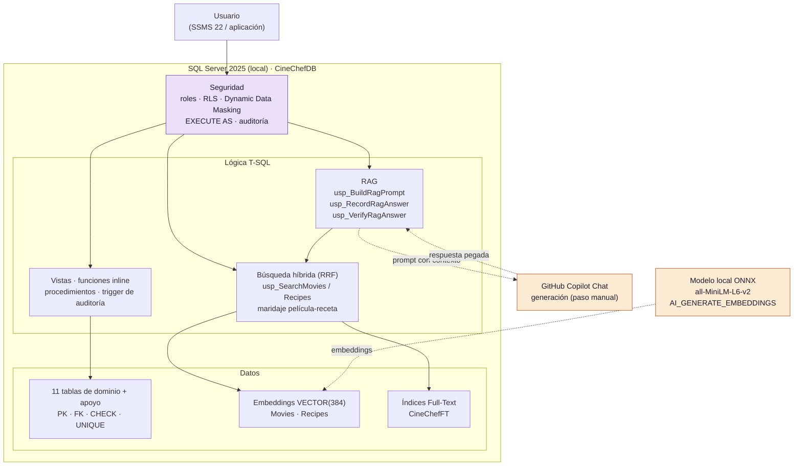

# CineChef - La noche de peli perfecta

Mini proyecto de la certificación **Microsoft DP-800: SQL AI Developer Associate**.
CineChef recomienda **una película y una receta que casen entre sí** a partir de una descripción libre del
estado de ánimo (una *vibe*), respetando alergias y control parental. Todo funciona **en local** sobre
**SQL Server 2025**, sin Azure ni Fabric.

> **Nivel seleccionado:** Nivel 3 - Avanzado
> **Modalidad:** individual · **Autora:** Noelia Segura Herrero
> **Repositorio:** https://github.com/noeliaseguraherrero/cinechef-dp800
> **Informe:** [docs/CineChef_informe_DP800.pdf](docs/CineChef_informe_DP800.pdf) · **Presentación:** [presentation/CineChef_presentacion_DP800.pptx](presentation/CineChef_presentacion_DP800.pptx)

## Estado del proyecto

| Fase | Contenido | Estado |
|---|---|---|
| 1. Preparación | Entorno, repositorio, modelo ONNX local | Completada |
| 2. Base de datos | Tablas, restricciones, datos de prueba | Completada |
| Bloque B | Desarrollo SQL asistido por IA (GitHub Copilot) | Completado (ver [documentación](docs/bloque_b_copilot.md)) |
| 3. Objetos T-SQL | Vistas, funciones, procedimientos, trigger de auditoría y consultas avanzadas | Completada |
| 4. Seguridad | Roles, RLS, Dynamic Data Masking, EXECUTE AS | Completada (ver [docs/seguridad.md](docs/seguridad.md)) |
| 5. Embeddings | Experimento de formato del texto y vectores del catálogo | Completada (ver [docs/embeddings.md](docs/embeddings.md)) |
| 6. Búsqueda | Búsqueda vectorial, Full-Text e híbrida (RRF) | Completada (ver [docs/busqueda.md](docs/busqueda.md)) |
| 7. RAG | Recuperación + contexto + generación manual en Copilot + verificación | Completada (ver [docs/rag.md](docs/rag.md)) |
| 8. Optimización | Lecturas lógicas y planes antes/después; índice vectorial | Completada (ver [docs/optimizacion.md](docs/optimizacion.md)) |
| 9. Cierre | Informe PDF, presentación, conclusiones | Completada |

## Descripción

Elegir qué ver y qué cocinar para una noche en casa es una decisión doble que los buscadores clásicos
(por género o por ingrediente) no resuelven, porque no entienden sensaciones. CineChef representa
películas y recetas como **vectores en el mismo espacio de embeddings**, de modo que una consulta como

> *"Estoy cansado, quiero algo reconfortante y nostálgico"*

puede buscar a la vez en ambos catálogos y proponer un maridaje, filtrando por las alergias del usuario y
su edad.

## Arquitectura



Diagrama también como imagen: [docs/arquitectura.png](docs/arquitectura.png). Modelo de datos (11 tablas de dominio y tablas de apoyo: identidad, auditoría, ejecuciones de embeddings y sesiones RAG): [docs/modelo_datos.png](docs/modelo_datos.png).

- Los **embeddings** se generan dentro de SQL Server con un modelo ONNX local.
- La **generación de texto** del RAG la realiza GitHub Copilot Chat. No se puede invocar desde T-SQL, por lo
  que ese paso es manual: SQL Server construye el contexto y el prompt, y el resultado se documenta como evidencia.

## Tecnologías

SQL Server 2025 (Developer), T-SQL, SSMS 22, ONNX Runtime, modelo all-MiniLM-L6-v2, GitHub Copilot,
PowerShell, Git y GitHub.

## Requisitos

- Windows 11.
- SQL Server 2025 con estas características instaladas:
  - Database Engine Services.
  - **Full-Text and Semantic Extractions for Search**.
  - **Machine Learning Services** (en SQL Server 2025 puede aparecer como *AI Services and Language Extensions*).
- SQL Server Management Studio 22.
- Git y PowerShell. Opcional: `sqlcmd` para el script de carga automática.
- Opcional: VS Code con GitHub Copilot (solo para reproducir el Bloque B; no hace falta para ejecutar la solución).

## Instalación

### 1. Clonar el repositorio
```powershell
git clone https://github.com/noeliaseguraherrero/cinechef-dp800.git
cd cinechef-dp800
```

### 2. Verificar el entorno
En SSMS, ejecuta `database/00_verify_environment.sql`. Debes ver versión mayor **17**, y `1` en
`full_text_instalado` y `machine_learning_services`. Si alguna es `0`, añade la característica con el
instalador de SQL Server (*add features to an existing installation*).

### 3. Crear la base de datos
Ejecuta `database/01_create_database.sql`. Crea `CineChefDB` con nivel de compatibilidad 170 y activa
`PREVIEW_FEATURES`.

### 4. Pruebas de humo
Ejecuta `tests/phase1_smoke_tests.sql`. Deben salir **8 pruebas en OK**: versión, compatibilidad, Full-Text,
Machine Learning Services, `PREVIEW_FEATURES`, tipo `VECTOR`, expresiones regulares y fuzzy matching.

### 5. Preparar el modelo de embeddings (ONNX local)
Los binarios y el modelo **no están en el repositorio** (ver `.gitignore`); hay que descargarlos:

1. Crear la carpeta `C:\onnx_runtime\model`.
2. Clonar el modelo dentro de `C:\onnx_runtime\model`:
   ```powershell
   cd C:\onnx_runtime\model
   git clone https://huggingface.co/nsense/all-MiniLM-L6-v2-onnx
   ```
   Comprueba que `model.onnx` pesa decenas de MB (si pesa pocos KB es un puntero de Git LFS: ejecuta `git lfs pull`).
3. Descargar **ONNX Runtime** (versión 1.19 o superior, Windows x64) y copiar `onnxruntime.dll` en `C:\onnx_runtime\`.
4. Obtener el tokenizador (se puede compilar desde `mlc-ai/tokenizers-cpp` o usar el que enlaza el artículo oficial
   de Microsoft sobre embeddings locales con ONNX) y **renombrarlo exactamente a `tokenizers_cpp.dll`**.
   Con otro nombre el modelo falla con el error 31739.
5. Ejecutar `ai/00_setup_onnx_runtime.ps1` en PowerShell **como administrador** (da permisos a `MSSQLLaunchpad`).
6. Desbloquear las DLL descargadas: `Unblock-File C:\onnx_runtime\*.dll`.

La carpeta debe quedar así:
```
C:\onnx_runtime\
├── onnxruntime.dll
├── tokenizers_cpp.dll
└── model\all-MiniLM-L6-v2-onnx\   (model.onnx, tokenizer.json, ...)
```

### 6. Registrar y validar el modelo
En SSMS, por este orden:
1. `ai/01_enable_ai_runtime.sql` (activa `external AI runtimes enabled`).
2. `ai/02_create_external_model.sql` (crea `CineChefEmbeddingModel`).
3. `ai/03_test_embeddings.sql`. Debe confirmar la dimensión **384** y que una frase parecida queda más cerca
   que una distinta.

> La sintaxis de `CREATE EXTERNAL MODEL` se basó en un artículo de Microsoft escrito para SQL Server 2025 RC0.
> Si no funciona en tu versión, compárala con la página actual de Microsoft Learn.

### 7. Crear las tablas y cargar los datos
Ejecuta en SSMS, por este orden exacto:

| Orden | Script | Contenido |
|---|---|---|
| 1 | `database/02_create_tables.sql` | 11 tablas de dominio (borra y recrea) |
| 2 | `database/03a_lookups.sql` | 18 géneros y 14 alérgenos |
| 3 | `database/03b_ingredients.sql` | 120 ingredientes y sus alérgenos |
| 4 | `database/03c_recipes.sql`, `03c2`, `03c3`, `03c4` | 100 recetas en 4 tandas |
| 5 | `database/03d_movies.sql`, `03d2`, `03d3`, `03d4` | 100 películas en 4 tandas |
| 6 | `database/03e_users_nights.sql` | 10 usuarios, 9 alergias, 30 planes |
| 7 | `database/04_views.sql` | 4 vistas |
| 8 | `database/05_functions.sql` | 2 funciones en línea |
| 9 | `database/06_audit_trigger.sql` | Tabla de auditoría y trigger de valoraciones |
| 10 | `database/07_procedures.sql` | 3 procedimientos almacenados |
| 11 | `database/09_security.sql` | Roles, usuarios de demostración, RLS, DDM y permisos |

O bien, en un solo paso (ver el apartado siguiente): `.\scripts\load_all.ps1`.

### 8. Generar los embeddings del catálogo (requiere el modelo del paso 6)
En SSMS, por este orden:
1. `ai/04_embedding_experiment.sql` (películas) y `ai/04b_recipe_probe.sql` (recetas): generan tres variantes del texto en tablas temporales y miden cuál ordena mejor (MRR, top-k). Elige la variante de cada tipo con sus resultados (películas: `labeled`; recetas: `plain`).
2. `ai/05_generate_embeddings.sql`: ajusta `@MovieVariant` y `@RecipeVariant` si has elegido otras y ejecuta. Rellena `Movies.Embedding` y `Recipes.Embedding` y registra la ejecución en `dbo.EmbeddingRun`.
3. `tests/phase5_embeddings_tests.sql`: comprueba que no falta ningún vector y que regenerar el texto da el mismo vector.
4. `ai/06_embedding_diagnostics.sql` (opcional): mide la distribución de distancias entre pares de películas y películas-recetas.

Estos scripts **no** forman parte de `scripts/load_all.ps1`, porque dependen del modelo ONNX preparado a mano.
Detalle y resultados del experimento en [docs/embeddings.md](docs/embeddings.md).

### 9. Búsqueda inteligente (Fase 6)
En SSMS, por este orden:
1. `ai/07_fulltext.sql`: catálogo e índices Full-Text sobre `Movies`, `Recipes` e `Ingredients`.
2. `ai/08_search.sql`: `usp_SearchMovies`, `usp_SearchRecipes` (búsqueda vectorial, Full-Text o híbrida con Reciprocal Rank Fusion) y `usp_SuggestRecipesForMovie` (maridaje película-receta), con sus permisos.
3. `tests/phase6_search_tests.sql`: 10 pruebas (índices, resultados, alergias, control parental, usuario inexistente, suplantación).
4. `ai/09_search_evaluation.sql` y `ai/09b_search_semantic_probes.sql` (opcionales): comparan vector, texto e híbrida con sondas.

Ejemplos: `EXEC dbo.usp_SearchRecipes @Query = N'comforting hot meal for a cold rainy evening', @UserId = 9;` y `EXEC dbo.usp_SuggestRecipesForMovie @MovieId = 1, @UserId = 9;`.
Tampoco forman parte de `load_all.ps1`. Resultados y limitaciones en [docs/busqueda.md](docs/busqueda.md).

### 10. RAG (Fase 7)
1. `ai/10_rag.sql`: tabla `dbo.RagSession` y procedimientos `usp_BuildRagPrompt`, `usp_RecordRagAnswer` y `usp_VerifyRagAnswer`.
2. `tests/phase7_rag_tests.sql`: 9 pruebas (contexto, alergias, edad, línea base, verificación, identidad).
3. `ai/11_rag_demo.sql`: demostración paso a paso. Se genera el prompt con `usp_BuildRagPrompt`, se pega en GitHub Copilot Chat (**paso manual**, Copilot no es invocable desde T-SQL), se registra la respuesta y se verifica. Las preguntas se escriben en inglés. Para la línea base sin RAG, usa `@WithContext = 0` en una conversación nueva de Copilot y sin acceso al repositorio (modo Ask).

Resultados, comparación RAG frente a LLM solo y limitaciones en [docs/rag.md](docs/rag.md).

### 11. Optimización (Fase 8)
1. `database/10_indexes.sql`: índice `IX_RecipeIngredients_IngredientId` (ya incluido en `scripts/load_all.ps1`).
2. `performance/12_perf_setup.sql`: crea el esquema `perf` con 100 000 recetas y 500 000 filas sintéticas (no toca las tablas reales).
3. `performance/13_perf_before_after.sql`: mide 3 consultas antes y después de crear índices y falla si cambia algún resultado.
4. `performance/13b_execution_plans.sql`: ejecuta Q1 y Q2 antes y después de los índices con el plan de ejecución real activado (Ctrl+M) para ver el cambio de Scan a Seek. Incluye una comprobación de que los índices no existen antes de medir "antes".
5. `performance/14_vector_index_experiment.sql` (opcional, **vista previa**): búsqueda vectorial exacta frente a índice DiskANN con 20 000 vectores aleatorios.
6. `performance/14b_warm_cache.sql` (opcional): repite la comparación anterior con la caché caliente (cada bloque se ejecuta 3 veces con `GO 3`; se anota la última).

Resultados y decisiones en [docs/optimizacion.md](docs/optimizacion.md). El esquema `perf` se puede borrar al terminar.

### 12. Verificar la carga
Ejecuta las pruebas en SSMS. Todas siguen el mismo patrón: tabla temporal con `OK`/`REVISAR` y un `THROW` final si alguna falla, para que el script no termine "en verde" con un fallo dentro.

| Script | Qué comprueba | Pruebas |
|---|---|---|
| `tests/phase1_smoke_tests.sql` | Versión, compatibilidad, Full-Text, ML Services, VECTOR, REGEXP, fuzzy | 8 |
| `tests/verify_counts.sql` | Recuento esperado y real de las 11 tablas | 11 |
| `tests/validate_data.sql` | Calidad de los datos (rangos, nulos, duplicados) | consultas |
| `tests/phase3_objects_tests.sql` | Vistas y funciones | 32 |
| `tests/phase3b_tests.sql` | Trigger, procedimientos y búsqueda por título | 16 |
| `tests/phase3c_adversarial_tests.sql` | Casos adversarios: receta sin ingredientes, valoración `NULL`, `UPDATE` de varias filas, rangos | 7 |
| `tests/phase4_security_tests.sql` | Seguridad, suplantando a cada usuario | 35 |
| `tests/phase5_embeddings_tests.sql` | Vectores almacenados y reproducibilidad | 8 |
| `tests/phase6_search_tests.sql` | Búsqueda, alergias, edad e identidad | 10 |
| `tests/phase7_rag_tests.sql` | RAG: contexto, verificación e identidad | 9 |

Total: **125 pruebas automáticas** en OK. La demostración visual de seguridad está en `tests/security_demo.sql`. Las consultas avanzadas de `database/08_advanced_queries.sql` son de solo lectura y se ejecutan a mano.

## Reproducibilidad desde cero

### Opción A: equipo nuevo
Sigue la sección **Instalación** completa (pasos 1 a 12). Los pasos 5 y 6 (ONNX) son manuales porque los
binarios no se distribuyen con el repositorio.

### Opción B: reiniciar la base de datos en tu equipo
Si el entorno y el modelo ONNX ya están preparados, recrea todo con un solo comando desde la raíz del repositorio:

```powershell
.\scripts\load_all.ps1                 # autenticación de Windows
.\scripts\load_all.ps1 -User sa        # autenticación SQL: pide la contraseña por pantalla
```

El script ejecuta con `sqlcmd` los archivos del paso 7 en orden, se detiene al primer error y termina con
`tests/verify_counts.sql`. La contraseña no se guarda en ningún archivo.

> `02_create_tables.sql` borra y recrea las tablas, así que el script se puede repetir. El modelo
> `CineChefEmbeddingModel` pertenece a la base de datos y no se toca.

### Opción C: borrar todo y empezar de cero
```sql
USE master;
ALTER DATABASE CineChefDB SET SINGLE_USER WITH ROLLBACK IMMEDIATE;
DROP DATABASE CineChefDB;
```
Después repite desde el paso 3 (la base de datos nueva necesita registrar de nuevo el modelo, paso 6).

### Resultado esperado

Este procedimiento se ha comprobado reconstruyendo el proyecto desde cero (octubre de 2026): base de datos borrada, instalación según este README y pruebas del paso 12 en OK.

`tests/verify_counts.sql` debe mostrar `OK` en las 11 tablas:

| Tabla | Filas |
|---|---|
| Genres | 18 |
| Allergens | 14 |
| Ingredients | 120 |
| IngredientAllergens | 39 |
| Recipes | 100 |
| RecipeIngredients | 500 |
| Movies | 100 |
| MovieGenres | 233 |
| Users | 10 |
| UserAllergies | 9 |
| MovieNights | 30 |

## Base de datos


Detalle y diagrama en Mermaid: [docs/modelo_datos.md](docs/modelo_datos.md).

| Tabla | Descripción |
|---|---|
| `Movies` | Título, año, duración, edad mínima (0/7/12/16/18), sinopsis y `Embedding VECTOR(384)` |
| `Genres`, `MovieGenres` | Géneros y relación N:M con películas |
| `Recipes` | Nombre, descripción, tiempo, dificultad (1-3), raciones y `Embedding VECTOR(384)` |
| `Ingredients`, `RecipeIngredients` | Ingredientes y relación N:M con recetas (cantidad y unidad) |
| `Allergens`, `IngredientAllergens` | Los 14 alérgenos de la UE y qué ingrediente contiene cada uno |
| `Users`, `UserAllergies` | Usuarios ficticios y sus alergias (datos sensibles) |
| `UserPrincipals` | Correspondencia entre cada usuario de la aplicación y su usuario de base de datos (la usa RLS) |
| `MovieNights` | Historial de planes: usuario, película, receta, vibe y valoración |

Decisiones de diseño:
- Claves primarias y foráneas en todas las tablas; claves compuestas en las tablas puente.
- Restricciones `CHECK` en años, edades, dificultad, valoraciones y formato del email; `UNIQUE` en nombres.
- Las columnas `Embedding` admiten `NULL` y se rellenan en la Fase 5.
- Solo se crean los índices básicos; los de optimización se añadirán después para poder comparar planes antes y después.

### Datos de prueba
- 100 películas reales y 100 recetas, en inglés. Los títulos y datos básicos de las películas son hechos públicos;
  **las sinopsis y descripciones las generó GitHub Copilot con texto propio**, y los usuarios son ficticios
  (emails `@example.com`). No se copia texto de ninguna web.
- El catálogo está en inglés porque el modelo de embeddings (all-MiniLM-L6-v2) está entrenado sobre todo en inglés.
- La generación asistida por IA está documentada, con prompts, correcciones y verificación, en
  [docs/bloque_b_copilot.md](docs/bloque_b_copilot.md).

## Funcionalidades DP-800 implementadas

| Área | Estado |
|---|---|
| Diseño de base de datos (PK, FK, constraints, tipos, índices básicos) | Hecho |
| Datos de prueba suficientes | Hecho (100 + 100 + usuarios y planes) |
| Desarrollo SQL asistido por IA (Bloque B) | Hecho y documentado |
| Modelo de embeddings local (ONNX) registrado y validado | Hecho |
| Vistas y funciones en línea (con pruebas) | Hecho |
| Procedimientos y trigger (con auditoría) | Hecho |
| Consultas avanzadas: CTE, window functions, JSON, regex, fuzzy matching | Hecho (`database/08_advanced_queries.sql`) |
| Seguridad (roles, RLS, Dynamic Data Masking, EXECUTE AS) | Hecho (ver [docs/seguridad.md](docs/seguridad.md)) |
| Generación de embeddings del catálogo y almacenamiento en `VECTOR(384)` | Hecho (ver [docs/embeddings.md](docs/embeddings.md)) |
| Búsqueda vectorial e híbrida (Full-Text + vectores, RRF) | Hecho (ver [docs/busqueda.md](docs/busqueda.md)) |
| RAG (SQL Server + contexto + Copilot) | Hecho (ver [docs/rag.md](docs/rag.md)) |
| Optimización de consultas (lecturas y planes antes/después, índice vectorial) | Hecho (ver [docs/optimizacion.md](docs/optimizacion.md)) |

## Ejemplos

### Verificación del modelo de embeddings
`ai/03_test_embeddings.sql` confirma que los vectores tienen 384 dimensiones y que el modelo capta significado.
Distancia coseno (0 = idénticos) entre una frase base ("A calm and comforting movie to relax on the sofa") y otras:

| Frase comparada | Distancia coseno |
|---|---|
| Película parecida ("A cozy, soothing film for a quiet evening at home") | 0,031 |
| Thriller violento | 0,091 |
| Receta de sopa de tomate | 0,140 |

El orden es el esperado (más parecido = menor distancia). El rango de valores es comprimido, así que la búsqueda
híbrida combinará **posiciones en el ranking** y no distancias en bruto.

### Validación de los datos
Resultado real de `tests/verify_counts.sql`: las 11 tablas en `OK`.

## Estructura del repositorio

```
cinechef-dp800/
├── README.md
├── .gitignore
├── scripts/
│   └── load_all.ps1            # recrea la BD y carga los datos
├── database/
│   ├── 00_verify_environment.sql
│   ├── 01_create_database.sql
│   ├── 02_create_tables.sql
│   ├── 03a_lookups.sql
│   ├── 03b_ingredients.sql
│   ├── 03c_recipes.sql ... 03c4_recipes.sql
│   ├── 03d_movies.sql  ... 03d4_movies.sql
│   ├── 03e_users_nights.sql
│   ├── 04_views.sql
│   ├── 05_functions.sql
│   ├── 06_audit_trigger.sql
│   ├── 07_procedures.sql
│   ├── 08_advanced_queries.sql
│   ├── 09_security.sql
│   └── 10_indexes.sql
├── ai/
│   ├── 00_setup_onnx_runtime.ps1
│   ├── 01_enable_ai_runtime.sql
│   ├── 02_create_external_model.sql
│   ├── 03_test_embeddings.sql
│   ├── 04_embedding_experiment.sql
│   ├── 04b_recipe_probe.sql
│   ├── 05_generate_embeddings.sql
│   ├── 06_embedding_diagnostics.sql
│   ├── 07_fulltext.sql
│   ├── 08_search.sql
│   ├── 09_search_evaluation.sql
│   ├── 09b_search_semantic_probes.sql
│   ├── 10_rag.sql
│   └── 11_rag_demo.sql
├── performance/
│   ├── 12_perf_setup.sql
│   ├── 13_perf_before_after.sql
│   ├── 13b_execution_plans.sql
│   ├── 14_vector_index_experiment.sql
│   └── 14b_warm_cache.sql
├── tests/
│   ├── phase1_smoke_tests.sql
│   ├── verify_counts.sql
│   ├── phase3_objects_tests.sql
│   ├── phase3b_tests.sql
│   ├── phase3c_adversarial_tests.sql
│   ├── phase4_security_tests.sql
│   ├── phase5_embeddings_tests.sql
│   ├── phase6_search_tests.sql
│   ├── phase7_rag_tests.sql
│   ├── security_demo.sql
│   └── validate_data.sql
├── docs/
│   ├── alcance.md
│   ├── modelo_datos.md / modelo_datos.png
│   ├── arquitectura.png
│   ├── bloque_b_copilot.md
│   ├── problemas_encontrados.md
│   ├── seguridad.md
│   ├── embeddings.md
│   ├── busqueda.md
│   ├── rag.md
│   ├── optimizacion.md
│   ├── CineChef_informe_DP800.pdf
│   ├── evidencias/             # capturas de SSMS y Copilot por fase (INDICE.md) y respuestas de Copilot sin editar
│   └── arquitectura.mmd        # fuente del diagrama de arquitectura
└── presentation/
    └── CineChef_presentacion_DP800.pptx
```

## Problemas encontrados

Resumen en [docs/problemas_encontrados.md](docs/problemas_encontrados.md). Los más relevantes:

| Problema | Causa y solución |
|---|---|
| Full-Text Search y Machine Learning Services no estaban instalados | Se añadieron a la instancia con el instalador de SQL Server |
| Error 31739 de `AIRuntimeHost` al generar embeddings | El tokenizador debía llamarse exactamente `tokenizers_cpp.dll` |
| Error 8116 al usar `AI_GENERATE_EMBEDDINGS` dentro de `VECTOR_DISTANCE` | La función devuelve `vector` solo al asignarla a una columna o variable `VECTOR`; se usó una tabla temporal con columna `VECTOR(384)` |
| La búsqueda en español no funciona | El modelo all-MiniLM-L6-v2 está entrenado sobre todo en inglés: catálogo y consultas en inglés, interfaz en español |
| Distancias coseno comprimidas (0,12 a 0,14 en el top 5) | La búsqueda híbrida combina posiciones (RRF) y no distancias en bruto |
| El enmascarado de datos no impide deducir el valor real | Se demostró el ataque por filtrado; con `DENY SELECT` falla (error 230). Mitigación documentada y no aplicada |
| La auditoría atribuía los cambios a `sa` | Se corrigió con `USER_NAME()` y `ORIGINAL_LOGIN()` tras verlo en la demostración de seguridad |
| La verificación del RAG no reconocía nombres traducidos | Se detecta la cita por id (`[R80]`, `[M5]`) |
| Líneas base del RAG contaminadas por la conversación | Se repitieron en chats nuevos, uno por pregunta y en modo Ask; se conservan las sesiones contaminadas como evidencia |
| Índice vectorial (DiskANN, vista previa): la tabla queda de solo lectura (error 42231) y `VECTOR_SEARCH` no se admite en `INSERT ... SELECT` (error 15805) | Con 100 elementos se usa la búsqueda exacta |

## Seguridad y secretos

No hay contraseñas, claves ni cadenas de conexión en el repositorio. Los usuarios de demostración se crean `WITHOUT LOGIN`, el script de carga pide la contraseña por pantalla si se usa autenticación SQL, y los binarios del modelo ONNX no se versionan (ver `.gitignore`). Todos los datos son ficticios.

## Conclusiones

**Qué funciona bien**
- Un diseño con restricciones en la base de datos, y una seguridad en capas (roles, RLS, enmascarado, `EXECUTE AS`) verificada con 125 pruebas ejecutables.
- Vectores y Full-Text dentro del motor, con un RAG cuya respuesta se verifica en SQL: solo se acepta lo recuperado, sin alérgenos del usuario y con edad apta.
- La seguridad se aplica en SQL **antes** de que ningún modelo vea datos.

**Qué resultó peor de lo esperado**
- La calidad semántica del modelo local es modesta y no entiende español.
- Con las sondas de esta práctica, el Full-Text supera a la búsqueda vectorial y la híbrida no mejora al texto. Las muestras son pequeñas (20 + 8 recetas, 7 películas), con criterio fijado por la autora, así que los números orientan pero no son una medición general.
- El RAG no mejora la redacción frente a un LLM solo: aporta trazabilidad y seguridad. Se probó con 3 preguntas y un modelo.
- El índice vectorial no compensa con 100 elementos y deja la tabla de solo lectura.

**Qué se aprendió sobre la IA asistida**
- GitHub Copilot (modo Agent, modelo Auto) acelera la generación de datos y la búsqueda de casos límite, pero nunca ejecutó el código en SQL Server y no distingue un defecto de un comportamiento correcto. Cada afirmación suya se aceptó solo con una prueba ejecutable (ver [docs/bloque_b_copilot.md](docs/bloque_b_copilot.md)).
- Claude (Anthropic) se usó como asistente para redactar el borrador de los scripts de las Fases 3 a 9 y la documentación; todo se ejecutó y verificó.

**Mejoras posibles**
- Un modelo de embeddings multilingüe o de mayor calidad.
- RRF ponderado, o reordenar los candidatos del Full-Text con el vector.
- Separar la pregunta en parte de receta y parte de película antes de recuperar.
- Salida estructurada (JSON con ids) para verificar el RAG de forma más robusta.
- Aplicar el `DENY SELECT` sobre las columnas enmascaradas y añadir SQL Server Audit.

**Medido:** los planes de ejecución (Scan frente a Seek) y la búsqueda vectorial con caché caliente están documentados en `docs/optimizacion.md`.
