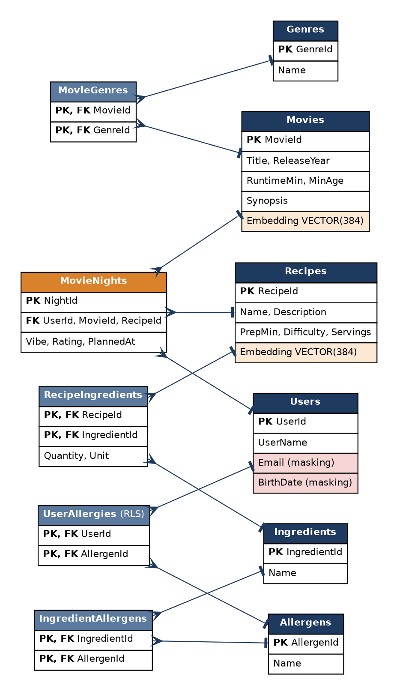
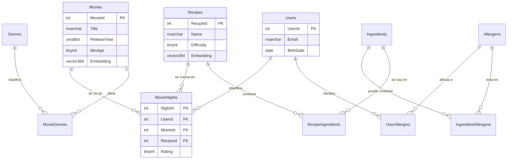

# Modelo de datos de CineChef

## Diagrama (Mermaid, se renderiza en GitHub)

## Resumen de tablas

| Tabla | Tipo | Notas |
|---|---|---|
| Movies, Recipes | Entidad | Incluyen `Embedding VECTOR(384)` (se rellena en la Fase 5) |
| Genres, Ingredients, Allergens | Catálogo | Nombre único |
| MovieGenres, RecipeIngredients, IngredientAllergens | Puente N:M | Clave primaria compuesta |
| Users, UserAllergies | Datos sensibles | Masking de email y fecha de nacimiento; RLS en alergias |
| MovieNights | Historial | Une usuario, película y receta |
