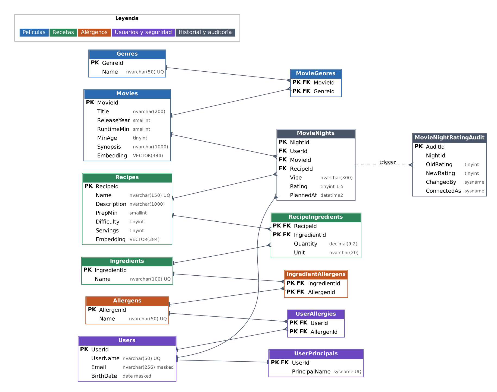
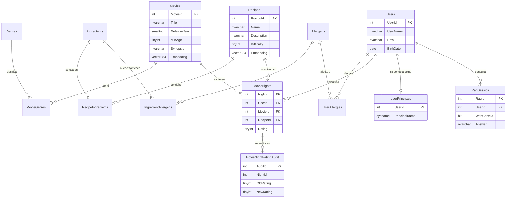

# Modelo de datos de CineChef

SQL Server 2025, base de datos `CineChefDB`. El modelo tiene **11 tablas de dominio** (el catálogo, los usuarios y el historial) y **4 tablas de apoyo** creadas por otras fases (identidad, auditoría, ejecuciones de embeddings y sesiones RAG). `tests/verify_counts.sql` comprueba las 11 de dominio.

## Diagrama (Mermaid, se renderiza en GitHub)

## Tablas de dominio (`database/02_create_tables.sql`)

| Tabla | Tipo | Notas |
|---|---|---|
| `Movies`, `Recipes` | Entidad | Incluyen `Embedding VECTOR(384)`, que se rellena en la Fase 5. `Movies.MinAge` solo admite 0, 7, 12, 16 y 18 (control parental); `Recipes.Difficulty` va de 1 a 3 |
| `Genres`, `Ingredients`, `Allergens` | Catálogo | Nombre único |
| `MovieGenres`, `RecipeIngredients`, `IngredientAllergens` | Puente N:M | Clave primaria compuesta. `RecipeIngredients.Quantity` es NULL cuando es "al gusto" |
| `Users`, `UserAllergies` | Datos sensibles | Enmascarado (DDM) del email y de la fecha de nacimiento; Row-Level Security en `Users` y `UserAllergies` (la propia persona, el nutricionista y el administrador) |
| `MovieNights` | Historial | Une usuario, película y receta. `Rating` es 1 a 5 o NULL. Row-Level Security con filtro y bloqueo: cada persona solo ve y escribe sus planes |

Restricciones principales: claves primarias y foráneas en todas las tablas, `UNIQUE` en nombres (y en `Movies(Title, ReleaseYear)`), y `CHECK` sobre año, duración, edad mínima, dificultad, raciones, cantidad, valoración, formato del email y fecha de nacimiento. Los borrados en cascada se aplican a las tablas puente y a las alergias del usuario.

## Tablas de apoyo (creadas por otras fases)

| Tabla | Creada en | Función |
|---|---|---|
| `UserPrincipals` | `02_create_tables.sql`, rellenada en `09_security.sql` | Relaciona cada `UserId` con el usuario de base de datos (`USER_NAME()`); lo usan RLS y los procedimientos para saber quién ejecuta la consulta. Los roles de aplicación no tienen acceso directo |
| `MovieNightRatingAudit` | `06_audit_trigger.sql` | Auditoría del trigger: valoración anterior y nueva, fecha, usuario de base de datos y inicio de sesión real |
| `EmbeddingRun` | `05_generate_embeddings.sql` | Una fila por generación de embeddings: tipo, variante, modelo, dimensiones y filas |
| `RagSession` | `10_rag.sql` | Traza de cada ejecución del RAG: pregunta, ids recuperados, prompt, respuesta y modelo |

## Índices

- `IX_MovieNights_UserId` e `IX_Movies_MinAge`: básicos, creados con las tablas.
- `IX_RecipeIngredients_IngredientId`: de optimización (Fase 8); se mide en `docs/optimizacion.md`.
- Índice Full-Text en el catálogo `CineChefFT` (`07_fulltext.sql`) para la búsqueda híbrida.
- No hay índice vectorial en las tablas reales: se probó solo en el esquema `perf` y deja la tabla de solo lectura.
