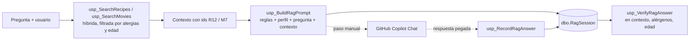

# RAG: recuperación + contexto + generación (Bloque G)

## Qué es RAG y en qué se diferencia de un LLM solo
- **LLM solo:** el modelo responde con lo que "sabe". Puede acertar, pero no está atado a nuestros datos: puede recomendar una receta que no existe en el catálogo y afirmar que es "sin gluten" sin que nadie pueda comprobarlo.
- **RAG (Retrieval-Augmented Generation):** antes de generar, se **recupera** de la base de datos lo relevante, se construye un **contexto** con ello y se le pide al modelo que responda **solo con ese contexto**. La seguridad (alergias, edad) se aplica en SQL **antes** de que el modelo vea nada, y la respuesta puede verificarse después contra la base de datos.

## Flujo implementado

GitHub Copilot no se puede llamar desde T-SQL, por eso la generación es un **paso manual documentado**: el prompt sale de SQL, se pega en Copilot Chat y la respuesta vuelve a SQL para guardarla y verificarla.

## Objetos (`ai/10_rag.sql`)
| Objeto | Función |
|---|---|
| `dbo.RagSession` | Traza de cada ejecución: pregunta, usuario, ids recuperados, prompt, respuesta, modelo y fechas. Sin acceso directo para los roles de aplicación |
| `usp_BuildRagPrompt` | Recupera 3 recetas y 3 películas (búsqueda híbrida de la Fase 6, ya filtrada por alergias y edad), monta el contexto y el prompt. Con `@WithContext = 0` genera la **línea base** sin contexto |
| `usp_RecordRagAnswer` | Guarda la respuesta de Copilot y el modelo usado |
| `usp_VerifyRagAnswer` | Detecta las recetas y películas citadas (por id `[R80]`, o por nombre) y comprueba: ¿estaban en el contexto?, ¿alérgenos del usuario?, ¿edad apta? |

**Prompt con contexto:** rol; usar **solo** el contexto; recomendar una película y una receta citando su id; no sugerir nada fuera del contexto; respetar los alérgenos; si nada encaja, decirlo; responder en español en ≤120 palabras. Después, perfil del usuario (edad y alérgenos), pregunta y contexto.
**Prompt de la línea base:** igual, pero sin contexto y con la frase *"You have no catalogue available: answer from your general knowledge and do not ask for more information"*. Con el primer prompt Copilot respondió que no podía recomendar nada sin contexto; ese rechazo no era una línea base útil.

Seguridad: mismo control de identidad que el resto de procedimientos (error 50030), usuario inexistente (50010), y pruebas automáticas en `tests/phase7_rag_tests.sql` (9 pruebas en OK).

## Experimento
Tres preguntas, escritas en inglés (el catálogo y el modelo de embeddings funcionan en inglés) y respondidas en español. Cada una se ejecutó **con RAG** y **sin RAG** en conversaciones de Copilot Chat independientes.

| Pregunta | Usuario | Sesión con contexto | Sesión sin contexto |
|---|---|---|---|
| 1. `a comforting dinner for a rainy night to watch with friends` | 9 (58 años; evita gluten y leche) | 9 | 18 |
| 2. `a scary movie night with a spooky dinner` | 3 (10 años; sin alergias) | 15 | 19 |
| 3. `authentic japanese ramen with pork belly and a samurai film` | 9 | 16 | 20 |

Generación con GitHub Copilot Chat (VS Code), selector de modelo en **Auto** (el plan solo permite Auto; Copilot no muestra el nombre del modelo concreto, por eso `RagSession.AnswerSource` guarda "GitHub Copilot Chat"). Las líneas base definitivas se ejecutaron en modo **Ask**. Fecha: **25/10/2026** (las horas de `RagSession` están en UTC; en Madrid, una hora más).

Sesiones anteriores conservadas en `RagSession` como evidencia del proceso: la 12 (sin respuesta: Copilot no podía recomendar sin contexto) y la 13, 14 y 17 (primeras líneas base, descartadas por contaminación entre conversaciones; ver hallazgo 4).

### Con RAG
| Preg. | Contexto recuperado | Respuesta de Copilot (resumen) | Verificación |
|---|---|---|---|
| 1 | Recetas R68, R73, R80; películas M40, M5, M77 | Sopa de gambas, coco y lima [R80] y *El apartamento* [M5] | **OK**: ambos en contexto, sin alérgenos ni problema de edad |
| 2 | Recetas R72, R11, R61; películas M10, M8, M77 | *Spirited Away* (desde 7 años) [M8] y risotto cremoso de champiñones [R11] | **OK** |
| 3 | Recetas R47, R24, R63; películas M55, M17, M25 | *Seven Samurai* [M17] y, como opción más cercana, cerdo al romero con manzanas [R24]. Indica que **no hay una combinación exacta**: ninguna receta del contexto es ramen ni lleva panceta | **OK** |

### Sin RAG (línea base)
| Preg. | Respuesta de Copilot (resumen) | Verificación SQL |
|---|---|---|
| 1 | *Chef* (2014) y curry de garbanzos y coco con arroz, "sin gluten y sin lácteos" | REVISAR: no cita ids ni usa los nombres del catálogo |
| 2 | *Coraline* (2009) y pizza momia | REVISAR |
| 3 | *Los siete samuráis* y ramen sin gluten con panceta y caldo; pide comprobar mirin, tamari y nori | REVISAR (y 1 falso "fuera de contexto", ver limitaciones) |

## Hallazgos
1. **Qué aporta RAG es trazabilidad y seguridad, no mejor redacción.** Las respuestas sin RAG son plausibles y hasta más literales en la pregunta 3 (dan un ramen). Pero sus recetas no están en el catálogo y sus afirmaciones de seguridad ("sin gluten", "apta para 10 años") son palabra del modelo y no se pueden comprobar en SQL. Con RAG, cada elemento recomendado existe en la base de datos, con sus alérgenos y edad mínima, y se verifica.
2. **El control parental y las alergias funcionan antes del modelo.** En la pregunta 2 el contexto del usuario de 10 años no incluye películas de terror (el filtro por edad las descarta) y Copilot elige *Spirited Away*. En la pregunta 1 el contexto solo contiene recetas seguras para gluten y leche.
3. **Con RAG el modelo admite que no hay respuesta perfecta.** En la pregunta 3 no inventó un ramen. Comprobación posterior: el catálogo sí tiene dos recetas de fideos (Sesame Ginger Noodles y Vegetable Coconut Noodle Soup), pero ambas llevan gluten y están descartadas para el usuario 9 por `fn_SafeRecipes`; y sin filtro tampoco entran en el top 5 de la búsqueda, dominada por las palabras de cerdo de la consulta. Es decir, "no hay ramen en el contexto" es cierto para este usuario, pero no equivale a "no hay ramen en el catálogo".
4. **Hallazgo metodológico: contaminación entre conversaciones.** Las primeras líneas base (sesiones 13 y 17) se ejecutaron en conversaciones que ya habían visto el prompt con contexto: la respuesta de la pregunta 3 citaba **[M17]**, un id que solo existe en el prompt con contexto, y la de la pregunta 1 recomendaba la misma película que la versión con RAG. Además, Copilot en modo agente puede leer el repositorio, que contiene el catálogo. Las líneas base definitivas se repitieron en **conversaciones nuevas, una por pregunta y en modo Ask**, y la contaminación desapareció. Las sesiones contaminadas se conservan en `RagSession` como evidencia.

## Limitaciones
- **La verificación depende de los ids.** Copilot responde en español y traduce los nombres, así que la señal fiable es la cita `[R80]`/`[M5]`. Una respuesta que traduzca los nombres y no cite ids no se reconoce. Además, la detección por nombre puede dar falsos positivos: la respuesta de la pregunta 3 sin RAG incluía "Akira Kurosawa" y se contó como mención de la película *Akira* del catálogo.
- **Solo 3 preguntas y un modelo.** Es una demostración, no una evaluación estadística; las respuestas de un LLM no son deterministas.
- **La recuperación usa la pregunta entera para recetas y películas.** Una pregunta que mezcla ambas intenciones (ramen + película de samuráis) confunde las dos búsquedas.
- **Idioma:** la consulta debe escribirse en inglés (MiniLM y catálogo en inglés).
- **La generación es manual** (Copilot no es invocable desde T-SQL) y su resultado depende de que se pegue el prompt completo.

## Mejoras posibles
Separar la pregunta en parte de receta y parte de película antes de recuperar; pedir salida estructurada (JSON con ids) para una verificación más robusta; usar un modelo de embeddings multilingüe; llamar a un modelo de generación vía `sp_invoke_external_rest_endpoint` si se dispusiera de un endpoint.
